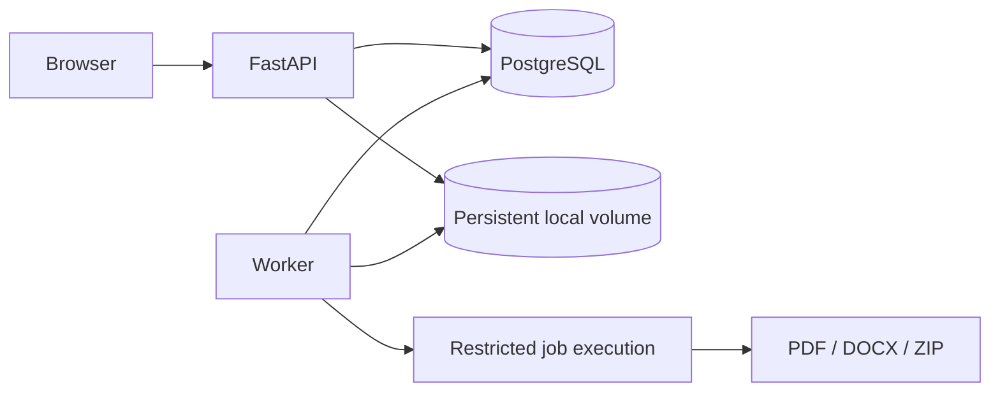
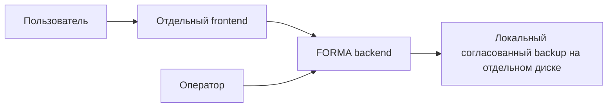
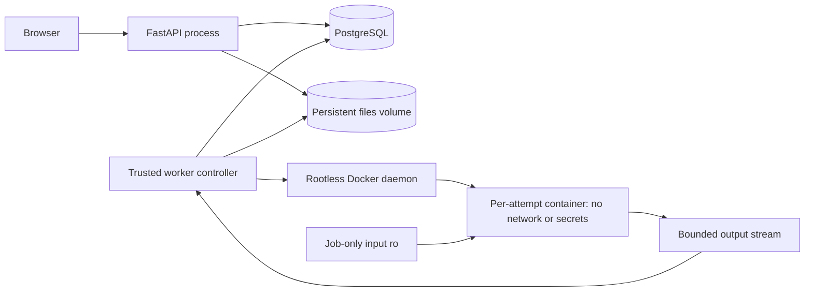
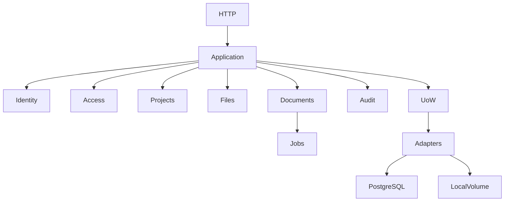

# Архитектура backend FORMA

Владелец: backend architect. Статус: draft. Обновлено: 2026-10-30.
Связи: BE-003, BE-006; [аудит](REPOSITORY_AUDIT.md); [допущения](decisions/assumptions.md).

Модульный монолит на Python/FastAPI/Pydantic v2. PostgreSQL содержит метаданные,
ACL, историю и очередь. Содержимое хранится в локальном постоянном Docker volume.
Тяжёлая обработка вынесена в worker-процесс того же релиза. Redis, Celery,
объектное хранилище и сетевые микросервисы не требуются.

## Границы

| Модуль | Ответственность | Внешний контракт внутри процесса |
|---|---|---|
| identity | Пользователи, пароли, сессии | Authenticate, RevokeSession |
| access | Роли и object-level authorization | RequireProjectPermission |
| projects | Жизненный цикл, настройки, шаблоны | CreateProject, UpdateSettings |
| project_files | Дерево, ревизии, storage orchestration | SaveFileContent, MoveProjectNode |
| documents | Snapshot, политика компиляции и экспорта | RequestCompilation, RequestExport |
| jobs | Очередь, lease, retry, отмена | ClaimJob, Heartbeat, CompleteJob |
| audit | Неизменяемый журнал значимых действий | RecordAuditEvent |

Routers валидируют транспорт, вызывают use case, преобразуют ошибки.
Use case управляет транзакцией через Unit of Work. Репозитории не делают commit.
Domain не импортирует FastAPI, SQLAlchemy или файловую систему. Protocol адаптера
живет на application-уровне; реализация — в infrastructure. Общие BaseService/BaseRepository
не вводятся. Транзакционные события аудита пишутся в той же транзакции.

## Конкурентность и сохранность

Сохранение текста принимает `expected_revision`. Устаревшая ревизия даёт 409;
повторная запись не перетирает чужое изменение. Изменения структуры сериализуются
блокировкой строки проекта. Все операции используют порядок блокировок project → node → revision.

Файл сначала записывается в staging на том же файловом разделе, проверяется SHA-256,
выполняются fsync и atomic rename в неизменяемый серверный storage_key. Затем БД
фиксирует ссылку. При rollback остаётся недостижимый blob, который удаляет GC после
grace period. Нельзя сначала фиксировать ссылку на ещё не опубликованный файл.
GC и backup должны учитывать выполняющиеся публикации; протокол требует отдельной спецификации.

Snapshot фиксирует revision проекта, manifest путей, SHA-256, размеры и engine.
Ссылки на версии фиксируются транзакционно до снятия блокировки проекта; копирование
в рабочую директорию выполняется после commit и не читает изменяемую текущую версию.

## Исполнение документов

Очередь использует `FOR UPDATE SKIP LOCKED`, lease и fencing token попытки.
Heartbeat и публикация результата принимаются только при совпадении token и живом lease.
Отмена и финальная публикация разрешаются атомарным переходом состояния job.
Повторяются только временные инфраструктурные ошибки; ошибка исходника терминальна.

Worker имеет доступ к БД и тому и потому не является security sandbox. Исполнитель
документа получает только вход конкретного задания, не получает DB credentials,
общий том или Docker socket. Требуются non-root, network none, read-only rootfs,
cap-drop ALL, no-new-privileges, PID/CPU/RAM/time limits и ограниченный writable workspace.
Механизм запуска и дисковые лимиты должны быть проверены на целевой Linux-платформе
до допуска недоверенных документов. До этого публичный запуск блокируется.

DOCX создаётся из LaTeX через Pandoc и нормализацию python-docx, никогда из PDF.
Матрица поддерживаемых конструкций и OOXML-тесты обязательны; визуальная идентичность
PDF и Word не обещается.

## Диаграммы

[Mermaid source](diagrams/context.mmd)

[Mermaid source](diagrams/containers.mmd)

[Mermaid source](diagrams/modules.mmd)

Полные решения: [ADR](adr/0001-modular-monolith.md), [storage](11_LOCAL_FILE_STORAGE.md), [sandbox](12_PDF_COMPILATION.md), [review](ARCHITECTURAL_REVIEW.md).
