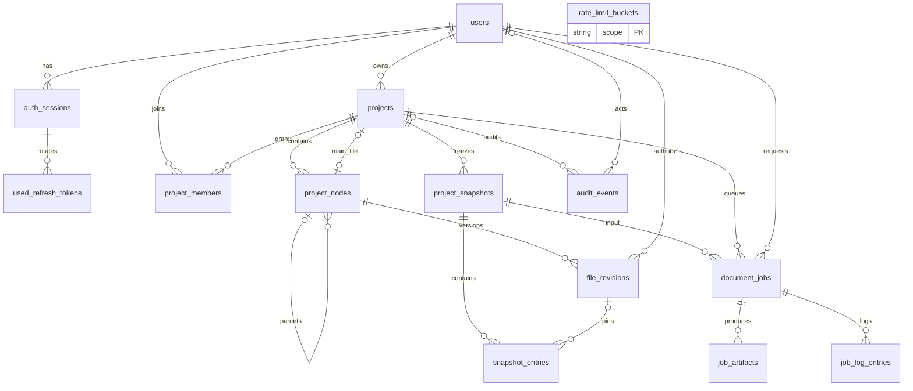

# PostgreSQL: модель и инварианты

Владелец: backend architect / backend-developer. Статус: draft. Обновлено: 2026-10-30.
Связи: BE-002–BE-007; ADR-0001–0007; проверки и задачи в [карте](tasks/ROADMAP.md).

Проектный SQL: [schema.sql](database/schema.sql). Словарь: [все поля](06_DATABASE_DICTIONARY.md).
14 таблиц; PostgreSQL production baseline 16, совместимый DDL проверяется также на 14.
UUID генерирует приложение, timestamptz хранит UTC. created_at=now() серверный;
updated_at обновляет use case при mutation, не автоматический обещанный trigger.

Owner представлен только projects.owner_id NOT NULL REFERENCES users ON DELETE RESTRICT.
В project_members нет роли owner; изменение owner не входит в API. Application запрещает
добавление самого owner в membership. Composite FK (project_id,parent_id) исключает чужого
родителя; (projects.id,main_file_id) исключает чужой main. Deferred semantic triggers проверяют
live .tex, тип parent и согласованность materialized path. Цикл не может удовлетворить
равенству пути parent/path + name при ограниченном ненулевом имени; application дополнительно
проверяет ancestor chain до записи. Блокировка project обязательна для всех tree mutations.

Node soft delete освобождает уникальность live path, история остаётся. Content storage key,
hash и size хранятся только в file_revisions, а Node DTO получает их join с latest revision.
Это осознанное устранение дублирования исходной примерной таблицы.
Snapshot_entries с RESTRICT FK удерживает версии от GC, в том числе после удаления узла.
Empty folders тоже попадают в snapshot. Snapshot и job создаются в одной DB-транзакции.

Статусы ограничены CHECK; переходы job — условными UPDATE в adapter по state + lease token.
CHECK не заменяет тест state machine. Cross-project snapshot/job и entry/revision проверяются
application под project lock; запрещён прямой SQL внешних клиентов. Дополнительные composite
FK можно добавить при появлении других writers через ADR.

Оценка для 1000 пользователей × 10 проектов × 100 файлов × 20 версий: 20 млн revisions.
Главный объём — blobs; индекс (node_id,revision) обеспечивает current/history без N+1.
Проекты листаются owner/member indexes; files bounded до 2000 узлов. jobs polling по PK,
claim partial state/queued_at; logs PK(job_id,sequence). Партиционирование пока не вводится.

## Диаграммы

[Mermaid source](diagrams/er.mmd)

