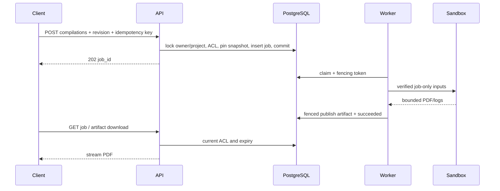

# PDF pipeline и sandbox

Владелец: backend architect / backend-developer. Статус: draft. Обновлено: 2026-10-30.
Связи: BE-002–BE-007; ADR-0001–0007; проверки и задачи в [карте](tasks/ROADMAP.md).

RequestCompilation фиксирует main_path/engine/entries в транзакции. Worker материализует
только manifest, проверяет sha256/size, запускает pdflatex/xelatex/lualatex без shell,
без пользовательских argv, stdin закрыт. Аргументы: -no-shell-escape -interaction=nonstopmode
-halt-on-error -file-line-error -output-directory=/work/out; main path из manifest.
TeX configuration openin_any=p, openout_any=p, TEXMFOUTPUT=/work/out, env whitelist.
До 3 проходов engine; bibtex при .aux citations, только фиксированный binary/argv в sandbox.
Пакеты и шрифты baked в image, никакого runtime tlmgr или сетевой установки.

Production target: Linux cgroup v2, rootless Docker daemon выделенного OS пользователя.
Trusted worker (host process с тем же Python lock/release)
имеет доступ к rootless daemon socket; это privileged controller, не parser.
API socket не получает. Каждый attempt — отдельный container с image digest allowlist,
non-root 65532, --network=none --read-only --cap-drop=ALL --security-opt=no-new-privileges,
стандартным seccomp, --pids-limit=64 --cpus=1 --memory=1g --memory-swap=1g.
Только конкретный job input bind ro; нет DB env, общего storage mount или daemon socket.
Writable /work tmpfs 512 MiB и /tmp tmpfs 32 MiB, nosuid,nodev; TeX запускается из /work.
Timeout PDF 60s; kill container по ID, wait exit, только затем slot освобождается.
Результат до остановки копируется через bounded archive stream Docker API; extraction
trusted controller отвергает symlinks/hardlinks, nonregular, traversal, output >100 MiB,
лишние файлы и неправильную сигнатуру PDF. Затем container удаляется, rootless scratch исчезает.

Это конкретный профиль BE-034, но он ещё не прошёл isolation suite. Cgroup limits в rootless
требуют делегирования systemd; startup self-test должен fail closed при невозможности
подтвердить network/PID/memory/disk ограничения. Docker Desktop подходит для разработки,
не является доказательством production isolation. Shared kernel остаётся остаточным риском.
При потере worker reconciler сначала kills container attempt по label, затем requeues;
DB fencing не заменяет остановку старого процесса для соблюдения resource limits.

Success: PDF signature + ненулевой pages probe внутри sandbox; trusted controller публикует
blob; fenced CompleteJob одной транзакцией добавляет artifact и succeeded. Ошибки компиляции
терминальные, log parser не исполняет TeX. file/line только при совпадении с manifest;
неуверенное сопоставление → null. Raw stdout ограничен 1 MiB, очищается от secrets/control.

## Диаграммы

[Mermaid source](diagrams/compile-sequence.mmd)

