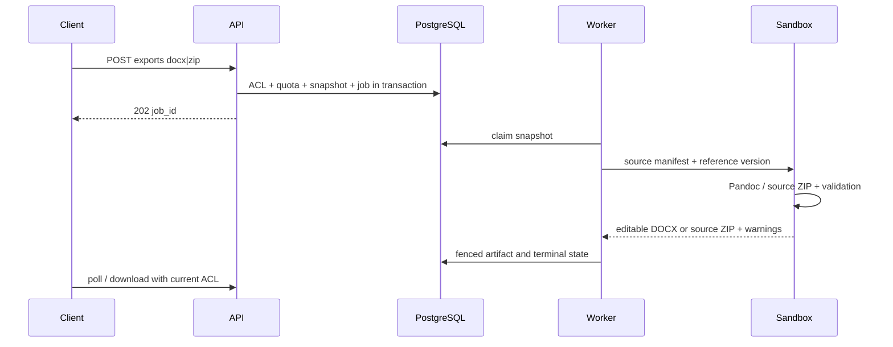

# Редактируемый DOCX

Владелец: backend architect / backend-developer. Статус: draft. Обновлено: 2026-10-30.
Связи: BE-002–BE-007; ADR-0001–0007; проверки и задачи в [карте](tasks/ROADMAP.md).

Pandoc читает LaTeX source snapshot, --from=latex --to=docx, встроенный reference.docx
forma-default-v1, фиксированный resource path, без custom filters/Lua/HTTP fetch.
Include expansion — bounded parser: максимум 20 уровней, 2000 файлов, cycle detection,
все ссылки только в manifest. Это не полноценный TeX interpreter. Sandbox тот же, 120s.
python-docx normalizer и OOXML validation выполняются тоже внутри sandbox как parsers.
После выхода trusted publisher проверяет размер/signature/whitelist имени без XML parsing.

| Конструкция | MVP | Структурная проверка / warning |
|---|---|---|
| Кириллица UTF-8, paragraphs | поддерживается | Текст в word/document.xml без потерь |
| section/subsection 1–3 | поддерживается | Heading 1–3 styles |
| emphasis/bold, lists | поддерживается | runs/numbering |
| Inline/display math | Pandoc-supported subset | m:oMath/m:oMathPara; не картинка |
| tabular simple | поддерживается | w:tbl + editable cells |
| multicolumn/multirow/longtable | ограниченно | DOCX_TABLE_DEGRADED; не обещать геометрию |
| PNG/JPEG figures | поддерживается | media + relationships + alt/caption |
| PDF figures | не поддерживается в DOCX | DOCX_IMAGE_UNSUPPORTED, placeholder caption |
| footnotes | поддерживается | footnotes.xml references |
| bib/cite | встроенный citeproc | bibliography editable text, не Word citation database |
| labels/ref | частично | DOCX_REFERENCE_DEGRADED, не гарантировать dynamic fields |
| TikZ/PSTricks/custom macros | не поддерживается | DOCX_UNSUPPORTED_CONSTRUCT + location |
| class/layout/page geometry | частично | DOCX_LAYOUT_APPROXIMATION |

reference.docx versioned seed: Normal, Title, Heading 1–3, Caption, Bibliography;
русский language ru-RU, шрифт с кириллицей, фиксированные margins. Пользовательские reference
не загружаются. Unsupported обнаруженный блок даёт warning/placeholder, не молчаливую потерю.
Фатальный parse → DOCX_CONVERSION_FAILED; warnings возвращаются через job logs level=warning
и поле warnings job response (bounded первые 100); полная пагинация через logs.
Validation ZIP: entry count≤10000, total uncompressed≤100 MiB, ratio≤100,
нет absolute/traversal/encrypted entries, обязательны [Content_Types].xml и document.xml,
внутренние relationships существуют, external links только http/https без fetch, DTD запрещён.
Golden structural сравнение игнорирует timestamps/relationship IDs, не требует byte equality.

## Диаграммы

[Mermaid source](diagrams/export-sequence.mmd)

