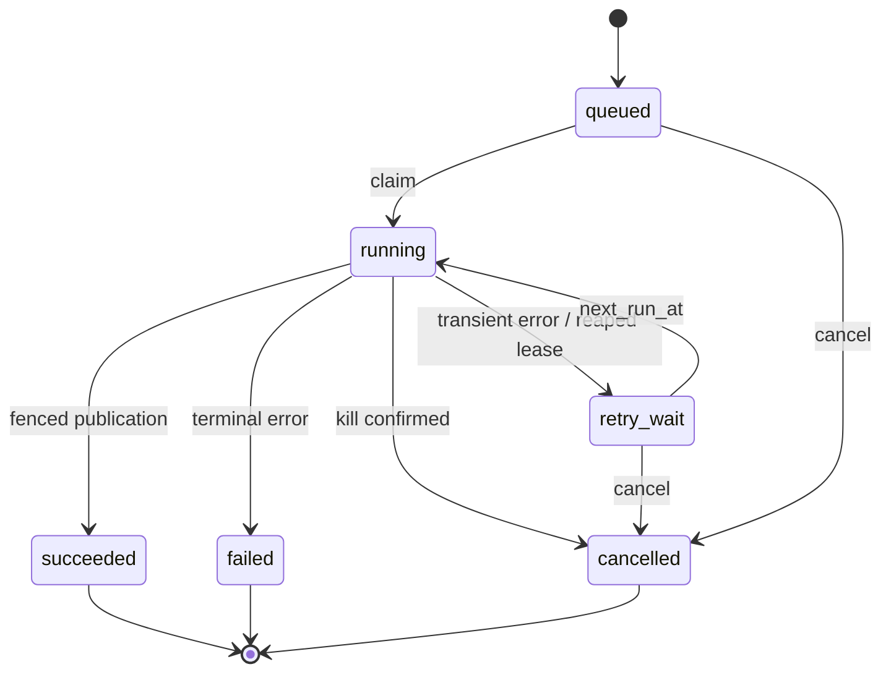

# PostgreSQL очередь

Владелец: backend architect / backend-developer. Статус: draft. Обновлено: 2026-10-30.
Связи: BE-002–BE-007; ADR-0001–0007; проверки и задачи в [карте](tasks/ROADMAP.md).

State: queued → running → succeeded/failed/cancelled; running → retry_wait → running.
Terminal неизменяем. attempt увеличивается при claim, max_attempts=3. Lease=30s,
heartbeat каждые 10s, SQL clock now(), polling worker 1s с jitter. Lock lease_token
создаётся заново для каждой попытки. UPDATE heartbeat/complete WHERE state=running
AND lease_token=:token AND lease_until>now(); rowcount=0 означает потерю владения.

```sql
WITH candidate AS (
 SELECT id FROM document_jobs
 WHERE state IN ('queued','retry_wait') AND next_run_at<=now()
 ORDER BY queued_at,id FOR UPDATE SKIP LOCKED LIMIT 1
)
UPDATE document_jobs j SET state='running', stage='snapshot', attempt=attempt+1,
 lease_token=:token, lease_until=now()+interval '30 seconds', heartbeat_at=now(),
 started_at=coalesce(started_at,now())
FROM candidate c WHERE j.id=c.id RETURNING j.*;
```

Это claim primitive; scheduler дополнительно удерживает global advisory lock на время
проверки slots и claim transaction. При slots>1 проверяет running count и per-project=1;
занятые проекты пропускает до выбора candidate. Default slots=1, user pending/running≤3,
project pending/running≤3. Enqueue quota сериализуется lock requester + owner (UUID order),
затем project. Не держать транзакцию открытой на время компиляции.

Retry только WORKER_LOST, TEMPORARY_IO, DATABASE_UNAVAILABLE после восстановления;
backoff 5s/30s + deterministic bounded jitter. TIMEOUT/OOM/invalid source/unsupported engine
не retry. Cancellation queued/retry_wait сразу terminal с finished_at; running флаг,
worker kills container, terminal cancelled; CompleteJob проверяет cancellation_requested
под lock, поэтому отмена, которая закоммитилась первой, побеждает публикацию.

Reaper expired lease: acquire scheduler lock; kill old container by exact job+attempt label,
убедиться exit; затем fenced transition в retry_wait или failed при исчерпании попыток,
очистить lease поля. При недоступном daemon не запускать replacement, поднять alert.
Logs максимум 1000 строк/1 MiB job, каждая ≤2000 chars; sequence monotonic под job lock;
последняя строка LOG_TRUNCATED. Старые attempts видны в message/code; raw stderr не отдавать.
Jobs/logs/idempotency 30 суток, artifacts 7; snapshots удерживаются до purge jobs.

## Диаграммы

[Mermaid source](diagrams/job-lifecycle.mmd)


