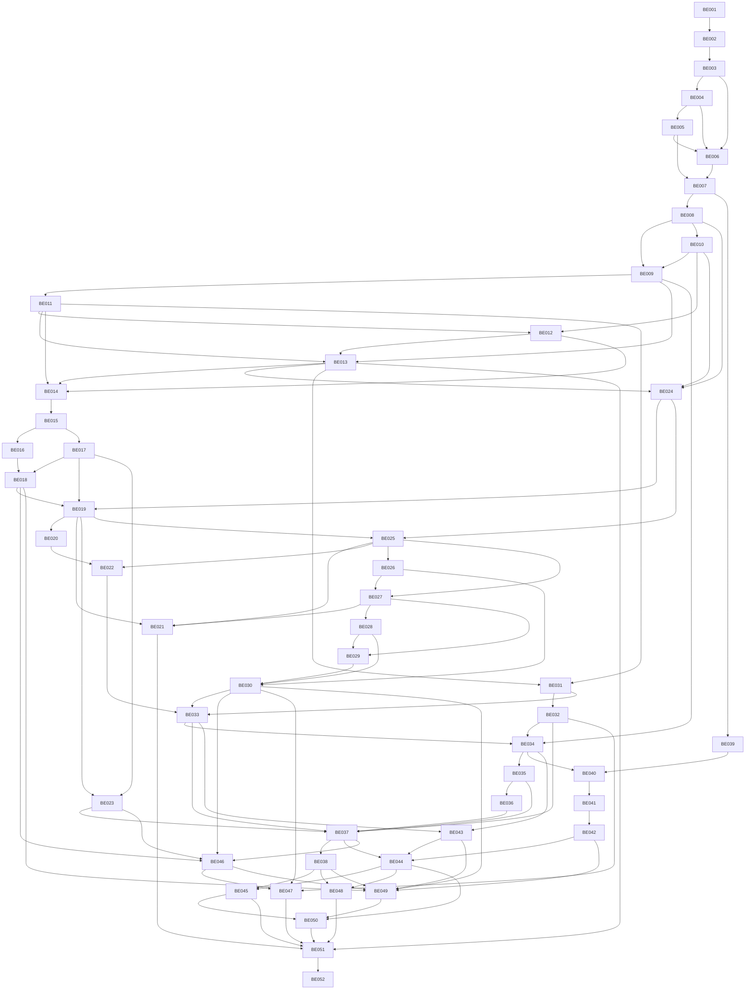

# Dependency DAG

Владелец: backend architect. Статус: draft. Обновлено: 2026-10-30. Связи: BE-001…052.

Самая длинная цепочка по числу зависимостей (не календарный CPM):
BE-001 → BE-002 → BE-003 → BE-004 → BE-005 → BE-006 → BE-007 → BE-008 → BE-010 → BE-009 → BE-011 → BE-012 → BE-013 → BE-014 → BE-015 → BE-016 → BE-018 → BE-019 → BE-025 → BE-026 → BE-027 → BE-028 → BE-029 → BE-030 → BE-033 → BE-034 → BE-035 → BE-036 → BE-037 → BE-038 → BE-045 → BE-050 → BE-051 → BE-052.

Для одного разработчика реальный срок определяется суммой работ; параллельные ветки DAG не означают параллельных сотрудников.
